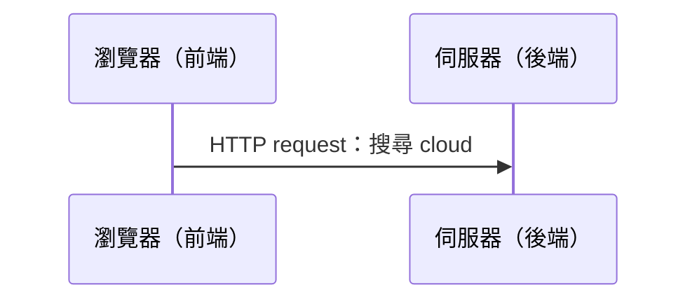
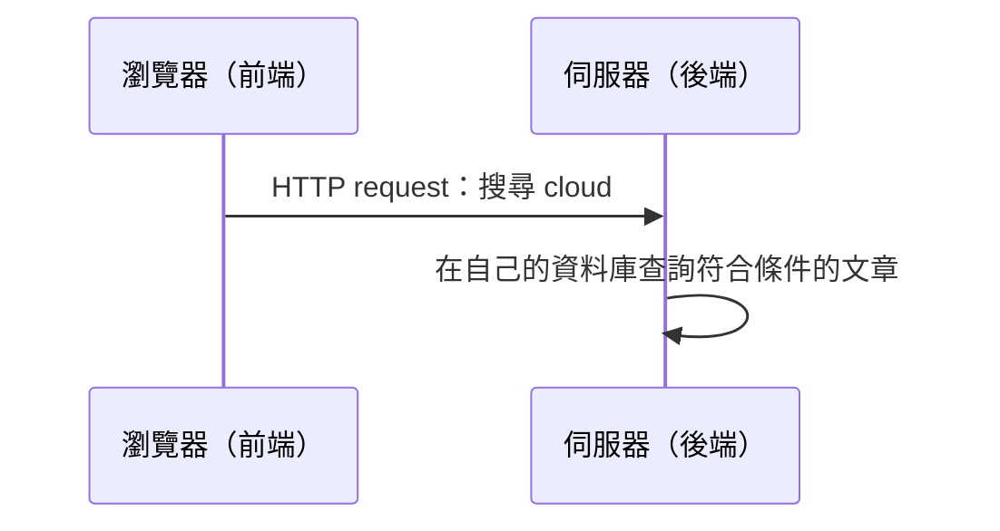
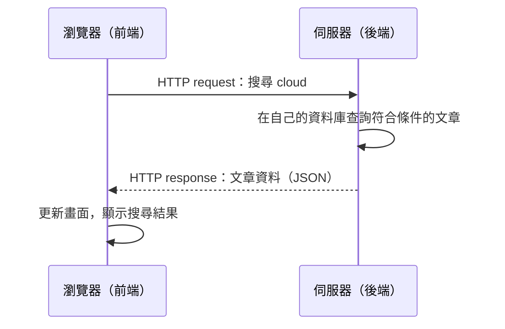
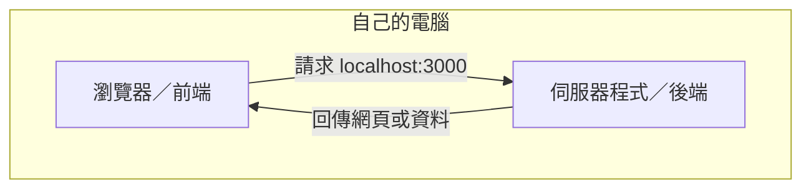
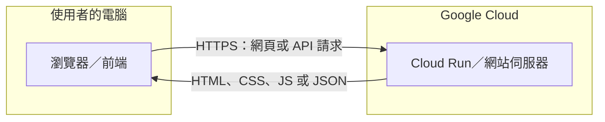
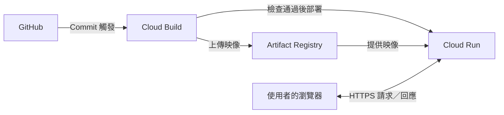

<!-- .slide: class="cover" data-background-image="/decks/gdg-5th-cloud-build/background.jpg" data-background-opacity="0.2" -->

# 讓你的網頁上雲端

## Cloud Build & Cloud Run

<hr>

<small>Presented by **Wolf Yuan**</small>

<!-- qr -->

## 課前確認你有

- 一台可以上網的電腦，以及瀏覽器
- **GitHub 帳號**，等等要 Fork 範本，請先登入
- **Google 帳號**，可以登入 Google Cloud Console
- 一個 Google Cloud 專案，以及建立資源、設定 IAM 的權限

今天主要用網頁介面操作，**不需要先安裝 Bun、Docker 或 VSCode**。

Note: 開課前先停在這一頁，讓大家確認帳號。課前確認組織政策允許建立服務帳戶、連接 GitHub，以及公開 Cloud Run 服務。若使用課程提供的專案，請管理者先完成帳單與權限配置。

---

<!-- .slide: class="cover" -->

假設我們已經寫好一個網站，在自己的電腦上也跑得動了。

## **接下來，要怎麼讓其他人也能用？**

---

<!-- .slide: class="cover" -->

# 網頁到底在哪裡跑？

---

## 打開網站的時候，發生了什麼？

瀏覽器取得網頁需要的 HTML、CSS 和 JavaScript，再把畫面顯示出來。

你可以點按鈕、輸入文字，也可能需要向伺服器取得新的資料。

<div class="fragment">

例如搜尋文章時，瀏覽器負責顯示搜尋框，伺服器負責查詢並回傳結果。

這就會用到我們常聽到的**前端**和**後端**。

</div>

---

## 前端是什麼？

前端負責使用者看到、操作的介面，以及瀏覽器裡的互動。

- HTML：網頁的結構，像是標題、段落和表單
- CSS：網頁的樣式，像是顏色、字型和排版
- JavaScript：處理點擊、輸入、資料請求與畫面更新

你在網站上看到的搜尋框、選單和載入動畫，都是前端的一部分。

---

## 後端是什麼？

後端是在伺服器上執行、處理請求的程式。

例如：

- 搜尋文章，回傳符合條件的結果
- 檢查登入資訊和使用者權限
- 讀寫資料、驗證輸入，再回傳處理結果

**伺服器也可以是你的電腦。** 只要它正在執行程式、接受請求，就可以扮演這個角色。

> 有後端*不代表*一定有資料庫，也可以只讀檔案、做計算，或呼叫其他服務。可以把它想成是廚房的後廚的角色

---

## 前後端怎麼講話？

前端可以透過 HTTP 請求呼叫後端提供的 **API**。

以搜尋文章為例：

1. 你輸入關鍵字，按下搜尋
2. 前端把查詢送給後端（透過 HTTP）
3. 後端找到符合條件的文章，回傳資料
4. 前端把結果顯示在畫面上

> API 可以先想成後端「對外提供功能的窗口」，呼叫它就能依照後端程式的設計，取得資料或請它做事。

---

## 第一步：前端送出請求

你輸入「cloud」，按下搜尋。瀏覽器把關鍵字送給後端。



這時前端可能顯示「搜尋中…」，等待伺服器回應。

---

## 第二步：後端處理

後端收到關鍵字，從資料裡找出符合條件的文章。



---

## 第三步：回傳資料，更新畫面

後端回傳 JSON，前端拿到結果後，把文章列表顯示出來。



**一次搜尋，就是這樣完成一趟請求和回應。**

---

## 每個網站都需要自己的後端嗎？

不一定，要看網站需要做什麼。

| 網站的需求 | 可以怎麼做 |
| --- | --- |
| 展示個人介紹、文章或作品 | 先產生靜態檔案，放到靜態網站託管服務 |
| 按按鈕、切換主題、在畫面上算數字 | 可以只用瀏覽器裡的 JavaScript |
| 登入、查詢非公開資料、處理訂單 | 需要後端程式或其他後端服務 |

前端和後端也不一定要拆成兩個專案，可以由同一個應用程式提供。e.g. Next.js

---

## 開發時通常怎麼做？

開發時，瀏覽器和伺服器程式可以都在同一台電腦。



> `localhost` 指的是正在開這個網址的那台電腦。把它傳給朋友，朋友不會突然連進你的電腦。
>
> Fun fact，`localhost` 背後指向的是 `127.0.0.1`，是一個特殊的 IP 叫做 loopback IP

---

## 我的電腦能跑，然後呢？

如果要讓別人連進來，還要處理外部能存取的位址、網路和服務的可用性。

你把電腦關掉、程式停掉，或網路斷掉，別人就用不到了。

<div class="fragment">

我們需要替網站準備一個合適的執行環境，並把程式發布過去。

這就是今天要處理的**部署**和**雲端託管**的概念。

</div>

---

## 程式託管？是啥？

託管通常分為以下幾種：

| 方案 | 適合什麼情境？ | 要注意什麼？ |
| --- | --- | --- |
| 自己的電腦 | 開發、測試、暫時展示 | 對外連線、持續開機與網路 |
| 靜態網站託管 | HTML、CSS、JS 等靜態檔案 | 後端要另外找地方執行 |
| 自管主機或雲端 VM | 需要自行控制執行環境 | 系統更新、網路、程式與服務管理 |
| 代管應用程式或容器平台 | 把應用程式交給平台執行 | 平台限制、資源設定與費用 |

**Cloud Run 屬於最後一類。** 方案怎麼選，要看網站需要什麼，以及你想自己管理多少東西。

---

## 為什麼不要自己架在自己的電腦上？

可以，你可以在自己的主機或雲端 VPS 安裝環境、啟動程式、設定網路和 HTTPS。

自由度很高，但你也要照顧作業系統、程式重啟和後續維護。

<div class="fragment">

如果我們想把時間放在網站本身，就可以把一部分執行環境的管理交給平台。

今天會用 **Cloud Run** 來做這件事。

Cloud Run 還可以根據你的流量自動做 scaling，面對更多流量時可以防止程式無法同時處理那麼多請求而掛點。

</div>

---

## 🐋 container

在把網站交給 Cloud Run 之前，先認識它要執行的東西。

你可以把 **映像（Image）** 想成打包好的執行環境，裡面有程式、套件與需要的檔案。

把映像啟動之後，正在執行的那一份就是**容器（Container）**。

- `Dockerfile`：描述怎麼把程式打包成映像
- Artifact Registry：存放建置完成的映像

> 把執行環境一起打包，能減少「我的電腦明明就可以跑」的環境差異，但程式本身還是可能有 Bug。

---

## Dockerfile 裡面寫什麼？

像是這樣：

```Dockerfile
FROM debian:13-slim

RUN apt update && apt install git

CMD ["echo", "Hello World from Debian 13!"]
```

今天不會多講，但可以把它想成是一步一步的食譜，讓 Docker 的 build engine 按照食譜把你需要的東西塞到一塊，把它打包在一起

---

## Cloud Run 幫忙做什麼？

Cloud Run 負責在 Google Cloud 上面把容器跑起來，接收瀏覽器送來的請求。然後額外的給你以下這些：

- 提供網站的 HTTPS 網址
- 管理執行網站的容器實例
- 依流量與設定調整實例數量

我們還是要寫好程式、設定權限和資源，但不用自己維護一整台主機。

> 今天會把網站的前端檔案與後端 API，放在同一個 Cloud Run 服務裡。

Note: 參考：https://docs.cloud.google.com/run/docs/overview/what-is-cloud-run 本課程使用 Cloud Run service，容器依 starter 設定監聽 0.0.0.0:8080。

---

## 部署後，誰在哪裡跑？

把伺服器程式部署到 Cloud Run，使用者透過公開的 HTTPS 網址連線。



前端的互動仍然在使用者的瀏覽器執行，後端程式則在雲端處理請求。

---

## 網站改版時，要再做一次嗎？

網站不是部署一次就結束了。改了程式，還要檢查、重新打包，再發布新版本。

每次自己做，可能會漏跑測試、拿錯版本，或忘記某個步驟。


Note: 先講每次手動更新網站的麻煩，再搭配梗圖停一下。下一頁才介紹用 Cloud Build 自動執行這些步驟。梗圖來源：https://mygo.miyago9267.com/ 原始圖片：https://storageapi.miyago9267.com/f/8fa714b7-dca7-466b-bfe4-f021b7237384.jpg

---

## Cloud Build 幫忙做什麼？

**我們想把更新網站的步驟寫下來，讓它每次照著跑。**

這裡就用 Cloud Build，讓它在雲端按照設定執行工作。

今天會讓它依序：

1. 檢查程式與設定、跑測試
2. 把網站打包成容器映像
3. 把映像存進 Artifact Registry
4. 呼叫部署指令，更新 Cloud Run

之後 GitHub 有新的 Commit，就能用同一套流程再跑一次。

Note: 參考：https://docs.cloud.google.com/build/docs/deploying-builds/deploy-cloud-run 本課程的四個步驟來自 starter 的 cloudbuild.yaml。Cloud Build 是執行建置工作的服務，不會在建置結束後繼續替網站處理使用者請求。

---

## 這幾個名字先分清楚

| 名稱              | 你可以在裡面找到什麼？              |
| ----------------- | ----------------------------------- |
| GitHub            | 原始碼、設定檔、Commit              |
| Cloud Build       | 每次建置的步驟、測試結果與日誌      |
| Artifact Registry | 建置完成的容器映像                  |
| Cloud Run         | 正在提供服務的網站、Revision 與日誌 |

**Build 負責準備版本，Run 負責執行版本。**

Cloud Run 可以執行其他工具建置的映像；今天用 Cloud Build，把檢查到部署的步驟串起來。

---

## 建置流程和使用網站，是兩件事



Cloud Build 完成工作後就結束；使用者打開網站時，是由 Cloud Run 接收請求。

---

<!-- .slide: class="cover" -->

# 用虛擬訂餐網站試試看

---

## 今天的部署練習

我們來建立一份自己的虛擬訂餐網站，名字叫做「今天吃什麼？」。

範本已經寫好前後端，使用 Next.js、Bun 和 HeroUI。大家會 Fork 一份，修改菜單，再把它部署出去。

**這次練習的重點，是讓一個現成的網站上線，並能持續更新。**


---

## 把前後端對照到這個網站

| 部分 | 在範本裡負責什麼？                     |
| ---- | -------------------------------------- |
| 前端 | 顯示菜單、處理購物車數量、更新畫面     |
| 後端 | 讀取 `config.json`、回傳菜單、隨機選餐 |
| API  | 讓瀏覽器取得菜單與推薦結果             |

按下「幫我選一餐」時，前端會請求 `/api/items/random`，後端回傳 JSON，前端再顯示餐點。

> 等網站上線後，我們會在瀏覽器的 Network 面板確認這個過程。

---

## 這個範本的範圍

今天直接從 `config.json` 讀取菜單，沒有外部資料庫。

| 有的功能               | 沒有的功能           |
| ---------------------- | -------------------- |
| 菜單 API、後端隨機選餐 | 登入、資料庫         |
| 購物車、模擬結帳       | 真正的付款、訂單儲存 |

重新整理會清空購物車，結帳只會顯示模擬結果。

> `config.json` 會一起包進映像。所以修改菜單後，就能練習重新建置和部署。

---

## Fork 今天的範本

請先打開 [github.com/wolf-yuan-6115/gdg-5th-cloud-build](https://github.com/wolf-yuan-6115/gdg-5th-cloud-build)。

1. 點右上角 **Fork**
2. Owner 選自己的 GitHub 帳號
3. 保留儲存庫名稱，選擇只複製預設分支
4. 點 **Create fork**

Fork 會在你的帳號底下建立一份副本，等等就能放心改自己的菜單。


Note: 參考：https://docs.github.com/en/pull-requests/how-tos/work-with-forks/fork-a-repo 今天用 Fork 複製範本。後面連接 Cloud Build 時，要選學員自己的 fork。

---

## 確認這是你自己的 Fork

現在儲存庫左上角應該是：

```text
你的帳號 / gdg-5th-cloud-build
```

找到這幾個檔案，先知道它們在哪裡就好：

- `config.json`：菜單，等等主要改這個
- `Dockerfile`：打包網站的做法
- `cloudbuild.yaml`：檢查、建置、推送和部署的順序


---

## 菜單長這樣

```json
{
  "items": [
    {
      "name": "滷肉飯",
      "description": "慢燉滷肉配上熱騰騰的白飯。",
      "category": "主食",
      "price": 65
    }
  ]
}
```

這裡只展示一項餐點。你可以修改原本的餐點，不需要把整份菜單刪掉。

---

## 改成自己的菜單

在 GitHub 打開 `config.json`，點鉛筆圖示編輯。

先把一項餐點改個名字，再把價格改成你想要的數字。

- 文字要包在雙引號裡，例如 `"雞腿便當"`
- 價格使用整數，例如 `100`，不要寫成 `"100元"`
- 保留原本的大括號、中括號與逗號


---

<!-- .slide: data-auto-animate data-auto-animate-id="edit-menu-example" -->

## 修改範例：先找到這項餐點

在 `items` 裡找到第一項「滷肉飯」，我們先只改 **name（名稱）**和 **price（價格）**。

<pre data-id="menu-example"><code class="language-json" data-trim data-line-numbers="2,5">{
  "name": "滷肉飯",
  "description": "慢燉滷肉配上熱騰騰的白飯。",
  "category": "主食",
  "price": 65
}</code></pre>

這裡只截出一項餐點。你的描述文字可能不同，先保留原本的就好。

> **不要把整份檔案換成這段！** 外面的 `items`、其他餐點和括號都要保留。

---

<!-- .slide: data-auto-animate data-auto-animate-id="edit-menu-example" -->

## 修改範例：改成這樣

把 `滷肉飯` 改成 `雞腿便當`，再把 `65` 改成 `100`。

<pre data-id="menu-example"><code class="language-json" data-trim data-line-numbers="2,5">{
  "name": "雞腿便當",
  "description": "慢燉滷肉配上熱騰騰的白飯。",
  "category": "主食",
  "price": 100
}</code></pre>

`name` 和 `price` 這些欄位名稱不要改，只改冒號右邊的值。

> 熟悉之後，也可以把 `description` 改成符合新餐點的描述，例如 `"烤雞腿配白飯與三樣配菜。"`。

---

## JSON 有幾個小地方要注意

| 要改的東西 | 正確寫法 | 容易寫錯的地方 |
| --- | --- | --- |
| 文字 | `"name": "雞腿便當"` | 要用半形雙引號 `"`，不要用 `「」` 或 `“”` |
| 價格 | `"price": 100` | 數字不加引號、元或 NT$ |
| 欄位之間 | `"category": "主食",` | 用半形逗號 `,` 隔開下一個欄位 |

同一項餐點最後的 `"price": 100` 後面**不要加逗號**。

餐點和餐點之間原本的 `},` 要保留。第一次先改名稱和價格，其他符號先不要動。

---

## 存下這次修改

點 **Commit changes**，訊息可以寫 `feat: update menu` 或是寫成自己喜歡的 commit 格式。

選擇直接提交到目前的預設分支，再確認一次。

**Commit 就是記錄一次修改**，等等可以用它確認 Cloud Build 到底抓了哪個版本。


Note: 這時還沒建立 Trigger，這次 Commit 不會自動部署。課程示範直接改自己的預設分支，並不需要向原作者送 Pull Request。

---

## Checkpoint!

現在你應該有：

- 自己帳號底下的一份 Fork
- 一份改過餐點名稱或價格的 `config.json`
- 一筆看得到的 Commit

**目前只是把檔案放在 GitHub，網站還沒有上線喔。**

---

<!-- .slide: class="cover" -->

# 準備 Google Cloud

---

## 在開始玩 GCP 之前

開始用 Google Cloud 建議先把語言改成英文


---

## 選對專案

打開 [https://console.cloud.google.com](https://console.cloud.google.com/)，從頂端的專案選擇器，選擇今天要用的專案。

- 確認帳單已啟用
- 記下 **Project ID**，不是顯示名稱，也不是 Project number
- 後面看到 `你的專案ID`，都要換成這個值


今天區域統一用 **`us-central1`**，避免前後設定對不起來。

Note: 使用專用的示範專案，避免混到既有服務。us-central1 沿用 starter，不代表所有建置、儲存和網路流量都免費。

---

## 啟用會用到的 API

進入 **APIs & Services / Library**，搜尋並啟用：

- Cloud Build API
- **Cloud Run Admin API**
- Artifact Registry API
- **Secret Manager API**
- Identity and Access Management (IAM) API
- Cloud Logging API
- **Cloud Resource Manager API**


Note: Secret Manager 用於 Cloud Build 的 GitHub connection 儲存授權資訊。參考：https://docs.cloud.google.com/build/docs/automating-builds/github/connect-repo-github 參考：https://docs.cloud.google.com/build/docs/deploying-builds/deploy-cloud-run

---

## 建立放映像的地方

搜尋 **Artifact Registry**，進入 Repositories，點 **Create repository**。

| 欄位          | 今天填什麼    |
| ------------- | ------------- |
| Name          | `food-demo`   |
| Format        | Docker        |
| Mode          | Standard      |
| Location type | Region        |
| Region        | `us-central1` |

Note: 參考：https://docs.cloud.google.com/artifact-registry/docs/repositories/create-repos 名稱需對上 cloudbuild.yaml 的 \_REPOSITORY。其餘選項維持適用於課程專案的預設值。

---

<div class="repository-screenshot">
  
</div>

---

## 誰有權限幫我們部署？

Google Cloud 會用 **Service Account（服務帳戶）**，讓程式以指定的身分工作。

今天分成兩個：

| 帳戶                | 負責什麼                   |
| ------------------- | -------------------------- |
| `food-demo-build`   | 跑建置、寫入映像、部署網站 |
| `food-demo-runtime` | 執行已經部署好的網站       |

網站執行時只需要讀容器裡的菜單，不需要拿到部署網站的權限。

---

## 建立執行網站的帳戶

進入 **IAM & Admin / Service Accounts**，點 **Create service account**。

1. 名稱與 ID 使用 `food-demo-runtime`
2. 建立後，略過額外的專案角色與使用者授權
3. 完成，記下帳戶的 Email

```text
food-demo-runtime@你的專案ID.iam.gserviceaccount.com
```


> 這裡把 food 打錯成 foot，記得不要照著打

Note: 參考：https://docs.cloud.google.com/iam/docs/service-accounts-create 不需要建立或下載服務帳戶金鑰。

---

## 建立負責建置的帳戶

再建立一個服務帳戶，名稱與 ID 使用 **`food-demo-build`**。

在授予專案存取權的步驟，加入：

| 角色            | 用途                         |
| --------------- | ---------------------------- |
| Cloud Run Admin | 建立、更新服務與設定公開存取 |
| Logs Writer     | 寫入建置日誌                 |

完成後複製它的 Email，等等會用到。


Note: 角色 ID：roles/run.admin、roles/logging.logWriter。這是 starter 的示範權限配置。參考：https://docs.cloud.google.com/build/docs/deploying-builds/deploy-cloud-run 參考：https://docs.cloud.google.com/build/docs/securing-builds/configure-user-specified-service-accounts

---

## 讓建置帳戶可以指定執行身分

在 **Service Accounts**，打開 **`food-demo-runtime`** service account。

在 **Principals with access** 裡，找到可以存取這個服務帳戶的 Principals，點 **Grant access**：

- Principal：`food-demo-build` 的完整 Email
- Role：**Service Account User**

這代表建置帳戶可以在部署時，指定網站使用 runtime 帳戶。


> 這裡把 food 打錯成 foot，記得不要照著打

Note: 角色 ID：roles/iam.serviceAccountUser。這個角色要加在 runtime 帳戶的存取政策，不是把 runtime 設成專案管理員。參考：https://docs.cloud.google.com/iam/docs/manage-access-service-accounts

---

## 讓建置帳戶可以上傳映像

回到 **Artifact Registry / Repositories**，選取剛剛的 `food-demo`。

在權限面板點 **Permissions**：

- Principal：`food-demo-build` 的完整 Email
- Role：**Artifact Registry Writer**

儲存後，Cloud Build 才能把映像放進這個 Repository。

<div class="image-flex"> 
  
  
</div>

Note: 角色 ID：roles/artifactregistry.writer。授權範圍是這個 Artifact Registry repository。參考：https://docs.cloud.google.com/artifact-registry/docs/access-control

---

## Checkpoint!

先不要急著按部署，確認一下：

- 專案與帳單準備好了，API 都已啟用
- `food-demo` 映像儲存庫在 `us-central1`
- build 和 runtime 兩個帳戶都建立好了
- build 能寫映像、寫日誌、部署服務，並使用 runtime 帳戶

權限名稱很多，搞混很正常，先停下來對一次比較快。

---

<!-- .slide: class="cover" -->

# 把 GitHub 接過來

---

## 連接 GitHub

進入 **Cloud Build / Repositories**，選 **2nd gen**，點 **Create host connection**。

- Provider：GitHub
- Region：`us-central1`
- Name：`github-demo`

點 Connect，依畫面完成 GitHub 授權與 Cloud Build GitHub App 安裝。

<div class="image-flex"> 
  
  
</div>
Note: 參考：https://docs.cloud.google.com/build/docs/automating-builds/github/connect-repo-github Console 可能調整頁面位置或翻譯，請以 Cloud Build repositories 的第二代 GitHub connection 為準。本課程不使用 Cloud Source Repositories。

---

## 選自己的 Fork

GitHub App 安裝時，Repository access 選 **Only select repositories**，勾自己的 `gdg-5th-cloud-build`。

回到 Cloud Build，確認 connection 已連線，再點 **Link repositories**：

1. Connection 選 `github-demo`
2. Repository 選你自己的 Fork
3. 點 **Link**

<div class="image-flex"> 
  
  
</div>

Note: 參考：https://docs.cloud.google.com/build/docs/automating-builds/github/connect-repo-github Fork、GitHub App 安裝與 Link repository 是不同步驟。若選不到自己的 Fork，先檢查 App 的 Repository access。

---

## 怎麼設定讓他自動跑？

這時候就要用到 **Trigger（觸發條件）**，它會告訴 Cloud Build：「這件事發生時，幫我跑一次。」

今天設定成：**自己的預設分支出現新的 Commit，就開始建置。**

在 Cloud Build 的 **Triggers** 頁面，點 **Create trigger**。


Note: 參考：https://docs.cloud.google.com/build/docs/automating-builds/create-manage-triggers GitHub 網頁直接 Commit 到分支會更新遠端分支，可觸發 push 類型的 Trigger。

---

## Trigger 的來源設定

| 欄位   | 今天填什麼           |
| ------ | -------------------- |
| Name   | `food-demo`          |
| Region | `us-central1`        |
| Event  | Push to a branch     |
| Source | 2nd gen，自己的 Fork |
| Branch | `^main$`             |

`^main$` 表示只符合完整的 `main` 分支名稱。

---

<div class="image-flex"> 
  
  
</div>

Link repository 之後，再把它選回去


---

## Trigger 要執行什麼？

繼續往下設定：

- Configuration：**Cloud Build configuration file (yaml or json)**
- Location：Repository，檔案路徑填 **`cloudbuild.yaml`**
- Service account：**`food-demo-build`** 的完整 Email

這樣才會跑範本裡完整的檢查與部署流程。


Note: 不要選只根據 Dockerfile 建置的設定，否則不會執行範本的 check 與 deploy 步驟。部分介面以 /cloudbuild.yaml 顯示根目錄路徑。參考：https://docs.cloud.google.com/build/docs/automating-builds/create-manage-triggers

---

## 確認部署參數

範本的 `cloudbuild.yaml` 已經設定好預設值：

| 參數          | 預設值        |
| ------------- | ------------- |
| `_REGION`     | `us-central1` |
| `_REPOSITORY` | `food-demo`   |
| `_SERVICE`    | `food-demo`   |

`_RUNTIME_SERVICE_ACCOUNT` 使用以下預設值，自動帶入**執行建置的專案 ID**：

```text
food-demo-runtime@${PROJECT_ID}.iam.gserviceaccount.com
```

沿用前面的帳戶名稱即可，不需要手動填自己的 Project ID。Trigger 若曾覆寫 `_RUNTIME_SERVICE_ACCOUNT`，請移除該覆寫，讓它使用範本設定。

Note: 巢狀 substitution 使用 `${PROJECT_ID}`，保留 YAML 的 dynamicSubstitutions: true。實際演練曾因未加大括號的 $PROJECT_ID 原樣傳到 deploy 而失敗，範本已修正。更新後確認 GitHub 上也是新版本，從 Trigger 重新 Run。若正確 Email 仍有 actAs denied，確認 build 帳戶對 runtime 帳戶有 Service Account User。參考：https://docs.cloud.google.com/build/docs/configuring-builds/use-bash-and-bindings-in-substitutions

---

## 第一次，手動按一下 Run

回到 **Triggers**，找到 `food-demo`，點 **Run**。

分支選剛剛設定的預設分支，再確認執行。

這次會抓該分支目前的版本；之後新的 Commit 才會自動觸發。


---

## 看看雲端在忙什麼

進入 **Cloud Build / History**，區域選 `us-central1`，打開這次建置。

你應該會看到四個步驟：

| 步驟     | 工作                       |
| -------- | -------------------------- |
| `check`  | 檢查菜單、lint、型別與測試 |
| `build`  | 用 Dockerfile 建置映像     |
| `push`   | 上傳到 Artifact Registry   |
| `deploy` | 更新 Cloud Run             |


---

## 第一關：先看看有沒有壞掉

`cloudbuild.yaml` 的第一個步驟長這樣：

```yaml
steps:
  - id: check
    name: oven/bun:1.4.4
    entrypoint: sh
    args:
      - -c
      - bun install --frozen-lockfile && bun run check
```

Cloud Build 會在 Bun 容器裡安裝套件，再執行 `check`。

**這關失敗，後面的 build、push、deploy 就不會繼續。**

---

## 它實際檢查了什麼？

`bun run check` 會依序檢查：

- `config.json` 是否有效，必要文字欄位有沒有填
- 價格是不是 **0 到 1,000,000 的整數**
- 程式的 lint、TypeScript 型別
- 菜單與 API 的單元測試

<div class="fragment">

測試不會保證程式永遠沒問題，但可以先擋下我們知道不合理的輸入。

例如：菜單的價格不能是負數，就可以先把這條規則寫成檢查。

</div>

---

## 第二關：把網站打包

Dockerfile 已經幫我們安排好：

1. 安裝固定版本的套件
2. 建置 Next.js 網站
3. 複製執行需要的程式、靜態檔案和 `config.json`
4. 用 Bun 啟動伺服器

Cloud Run 會把請求送到容器的 `PORT`，今天設定為 **8080**。

> 範本已經處理好監聽 `0.0.0.0`，今天不需要修改 Dockerfile。

Note: 對照 starter 的 Dockerfile。容器合約參考：https://docs.cloud.google.com/run/docs/container-contract

---

## 第三關：存好這次的映像

建置成功後，`push` 會把映像上傳到 Artifact Registry。

今天每次建置用 **`$BUILD_ID`** 當映像標籤，可以分辨不同版本。

在 **Artifact Registry / food-demo** 裡，打開映像，就能查看版本與標籤。


Note: 映像路徑由 \_REGION、$PROJECT_ID、\_REPOSITORY、\_SERVICE 與 $BUILD_ID 組成。GitHub repository 存原始碼，Artifact Registry repository 存建置產物。

---

## 第四關：交給 Cloud Run

範本的 `deploy` 步驟會用剛剛的映像部署 `food-demo`。

今天設定為：

- 公開存取，朋友不用登入就能打開
- 1 CPU、512 MiB 記憶體
- 最少 0、最多 1 個實例
- 使用 `food-demo-runtime` 執行

> 最少 0 個實例代表沒有流量時可以縮到零，不代表所有資源都不收費。

Note: 設定來自 starter 的 cloudbuild.yaml。max-instances 不是帳單硬上限；映像儲存、建置、日誌與網路等仍可能產生費用。若組織政策禁止 allUsers 公開存取，請管理者處理，不能靠重按 Run 解決。

---

## 網站上線了！

確認 Cloud Build **全部成功**後，進入 **Cloud Run / Services**，點開 `food-demo`。

找到服務的 **URL**，用新分頁打開。

你應該能看到剛剛在 GitHub 改過的菜單。


---

<!-- .slide: class="cover" -->


---

## 來點個餐

試著加入餐點、調整數量，再按「幫我選一餐」。

也可以把 **Cloud Run 的網址**傳給旁邊的人，看看他能不能打開。

---

## 真的有後端嗎？

開啟瀏覽器開發者工具的 **Network** 面板，選 **Fetch/XHR**。

按一次「幫我選一餐」，找到 `/api/items/random`，點開 **Response**。

你會看到後端回傳的 JSON，前端就是拿這份資料更新畫面。

<div class="image-flex">
  
  
</div>

Note: Windows / Linux 可用 F12 或 Ctrl+Shift+I，macOS 可用 Cmd+Option+I。不同瀏覽器名稱可能略有差異。後端隨機抽選可以連續抽到同一餐，重複不是錯誤。

---

## 直接打開 API 看看

在你的 Cloud Run 網址後面加上這些路徑：

| 路徑                | 會看到什麼   |
| ------------------- | ------------ |
| `/api/items`        | 全部菜單     |
| `/api/items/item-1` | 第一項餐點   |
| `/api/items/random` | 隨機一項餐點 |

API 回傳資料，不一定會回傳一個漂亮的網頁。

> `item-1` 是後端依順序產生的 ID。空菜單時，單品和隨機端點會回傳 404。

---

## Checkpoint!

現在我們可以把前面的名詞跟畫面對起來了：

- **前端**：瀏覽器裡看得到的菜單和購物車
- **後端**：Cloud Run 裡讀菜單、處理 API 的程式
- **Cloud Build**：替這個版本跑檢查和建置的地方
- **Cloud Run**：持續接收使用者請求的服務

按完 Run 不算完成，**網址真的能開、API 能回資料**才算。

---

<!-- .slide: class="cover" -->

# 改一次，讓它自己部署

---

## 試著發布一次菜單更新

回到自己的 GitHub Fork，編輯 `config.json`。

挑一項餐點，把價格改成另一個合法整數，例如 `80`，再 Commit 到預設分支。

這次先不要按 Run，直接到 **Cloud Build / History** 看看。

**Trigger 應該會因為這筆 Commit，自動開始新的建置。**


---

## 這次到底更新了什麼？

等建置完成，再檢查：

1. Cloud Build 有新的 Build ID，來源是剛剛的 Commit
2. Cloud Run 出現新的 Revision
3. 打開**同一個服務網址**，重新整理後看到新價格

Revision 可以先想成 Cloud Run 的一次部署版本。


Note: 首次部署後未手動更改流量配置時，這套部署流程會讓新版本接收流量。若曾手動固定流量到舊 Revision，請在 Manage traffic 確認流量指向新版本。

---

<!-- .slide: class="cover" -->

# 那我們來把它弄壞

---

## 一碗飯，負一元

再去 GitHub，把其中一項餐點的 `price` 改成 **`-1`**，然後 Commit 到預設分支，把修改送上 GitHub。

```json
{
  "name": "滷肉飯",
  "description": "這是一筆用來測試價格驗證的資料。",
  "category": "主食",
  "price": -1
}
```

這是單項餐點的片段，修改原本那一項的價格就好。

---

## 叭叭！

修改送上 GitHub 後，Trigger 會自動開始新的建置。

1. 打開 **Cloud Build / History**，區域選 `us-central1`
2. 找到剛剛那筆 Commit 對應的建置
3. 等待執行結果，這次應該會看到 **Failed**


Note: 先完成 GitHub 網頁 Commit（更新遠端分支並觸發建置），實際看到 Cloud Build 失敗，再切到下一頁「為什麼不行」梗圖。不要還沒看結果就先破梗。

---

<!-- .slide: data-background-image="/decks/gdg-5th-cloud-build/images/mygo-why-not.jpg" data-background-size="contain" data-background-color="#000000" aria-label="MyGO 梗圖：為什麼不行" -->

---

## 為什麼不行？

因為我們規定價格不能是負數，`check` 會先把這個版本擋下來。

```ts
if (
  !Number.isSafeInteger(record.price) ||
  (record.price as number) < 0 ||
  (record.price as number) > 1_000_000
)
  throw new Error(
    `Item ${index + 1} ("${record.name}"): price must be an integer between 0 and 1000000; received ${JSON.stringify(record.price)}`,
  );
```

~~這次是故意弄壞的，真的~~

---

## 紅色不是重點，錯在哪才是

打開失敗的 Build，點 **`check`** 的日誌。

找到 `config.json validation failed`，後面會指出餐點與價格的問題。

- `check` 失敗
- `build`、`push`、`deploy` 沒有執行
- 這個負價格版本沒有部署出去


---

## 那原本的網站呢？

重新整理 Cloud Run 的服務網址。

**之前成功部署的版本應該仍然可以使用，價格也維持原本的值。**

這次 `check` 就停住了，還沒走到部署，因此不會替換正在服務的版本。


Note: 這裡描述的是「check 失敗、deploy 尚未執行」的情境，不宣稱所有部署失敗都會自動回滾。

---

## 把價格救回來

在 GitHub 把 `-1` 改回合法價格，再 Commit 一次。

等新的建置全部成功後，確認 Cloud Run 的新 Revision 和網站內容。

<div class="fragment">

我們剛剛做完一輪：

**修改程式、觸發檢查、看到失敗、修正，再成功部署。**

不需要每次自己登入主機，重新安裝套件和啟動服務。

</div>

---

## 這就是今天的 CI / CD

**CI（Continuous Integration）**：程式變更後，自動做建置與檢查，提早找到問題。

**CD** 常見有兩種意思：

- Continuous Delivery：準備好可發布的版本，上線可保留人工決定
- Continuous Deployment：通過檢查後，自動部署

今天這條流程在檢查成功後會直接部署，做的是後者。

> Cloud Build 執行這條流程，Cloud Run 執行我們發布出去的網站。

---

## 如果它沒有照劇本走

| 狀況 | 先看哪裡 |
| --- | --- |
| Commit 後沒有 Build | Trigger 的 Fork、分支規則與啟用狀態 |
| `check` 失敗 | 該步驟最早的錯誤訊息、JSON 格式與價格 |
| `push` 被拒絕 | Repository 名稱、區域、Writer 權限 |
| `deploy` 被拒絕 | build 帳戶權限、runtime 的使用權限、組織政策 |
| 網址開不起來 | Cloud Run 的日誌、Revision 狀態與公開存取設定 |
| 還是舊菜單 | Build 的來源 Commit、是否成功、Revision 流量 |

> 先看日誌，再求救。一直按 Run 通常不會把權限問題按好。

---

## 下課前，記得清理資源

如果只為今天建立這些資源，操作完請清理：

1. Cloud Build / Triggers：先停用或刪除 `food-demo`
2. Cloud Run：刪除 `food-demo` 服務
3. Artifact Registry：刪除今天的 `food-demo` Repository 與映像
4. Cloud Build / Repositories：解除連結並刪除今天的 connection

**關掉瀏覽器，不會幫你關掉雲端服務。**

### 請記得跟著步驟關掉服務（除非你想要讓他繼續跑）

不關掉有幾率會收錢，不保證課程提供的 credit 夠用。

---

## 還有這些要確認

- IAM：移除這次額外加的角色，刪除兩個示範服務帳戶
- Secret Manager：檢查 connection 使用的 Secret，只清掉確定不再使用的項目
- GitHub Settings / Applications：檢查 Cloud Build App，移除不再需要的儲存庫存取權
- Billing：確認費用與剩餘資源，日誌會依保留政策到期

如果整個專案只用於今天，也可以在 **IAM & Admin / Settings** 關閉專案。

> 刪除前先確認專案和名稱，尤其不要把別堂課或別人的資源一起刪掉。

---

<!-- .slide: class="cover" -->

# 課程到這裡結束！

## 有問題歡迎問我~

<hr>

<small>
  Website: <a href="https://wolf-yuan.dev">wolf-yuan.dev</a>
  <br>
  Instagram: <code>wolf.yuan</code>
  <br>
  Fully open sourced! Visit <a href="https://gitlab.com/wolf-yuan/presentation/">wolf-yuan/presentation on GitLab</a>
</small>
